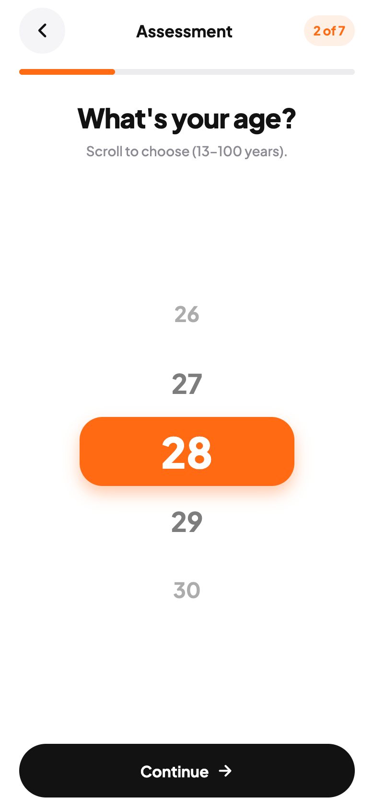
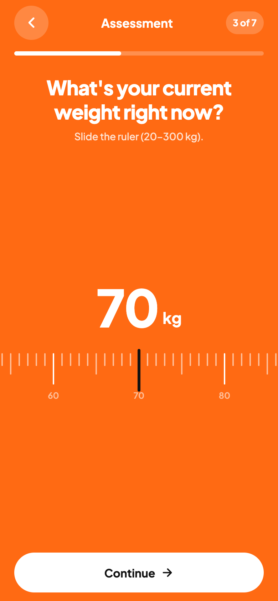
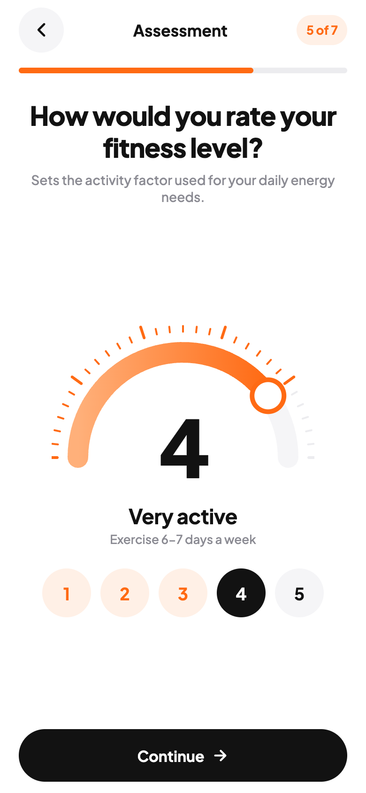
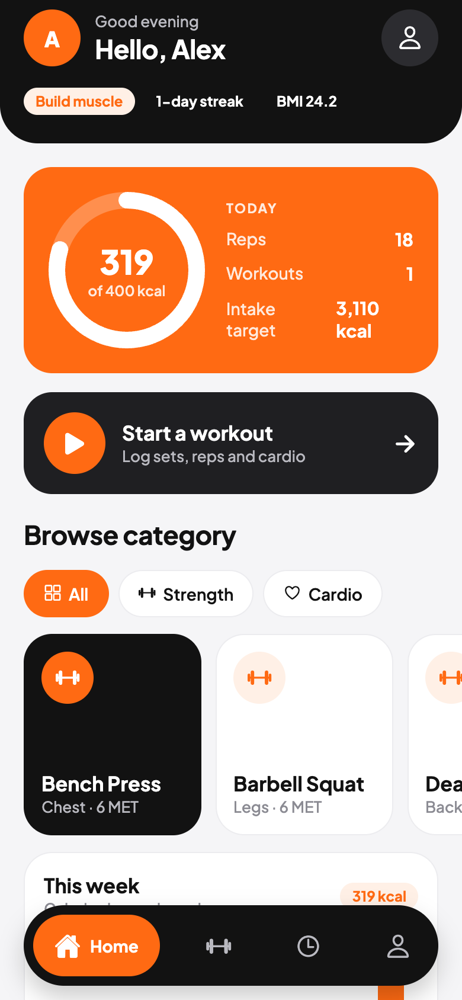
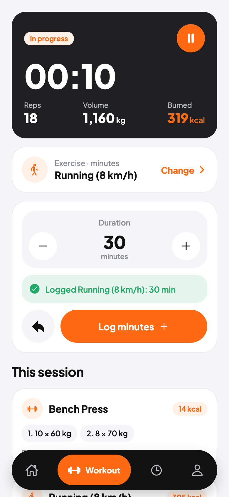

# FitTrack — Fitness & Workout Tracking App

FitTrack is an offline-first mobile app for logging workouts. It calculates calories burned, reps, training volume, an estimated 1-rep max, BMI, BMR and TDEE, and recommends a daily calorie target based on your goal. It is built by a single developer using the Personal Software Process.

| | |
|---|---|
| Platform | **React Native 0.88 + Expo SDK 58** (TypeScript, Expo Router). Runs on Android, iOS and web. |
| Testing | **Unit** (calorie/rep calculations) · **Boundary value** · **Usability** · state-transition: 221 Jest cases |
| UML | **Use Case · Class · Activity · State** |
| Estimation | **Basic COCOMO** (organic) |
| Process | **PSP** (time and defect logs, size measurement, review checklists) |

<p>





</p>

## Quick start

Requires Node 22.13+.

```bash
cd mobile
npm install

npm test                 # 221 Jest cases: unit, boundary, state machine
npm run typecheck        # tsc --noEmit
npx expo start           # scan the QR code with Expo Go, or press a / i / w
```

To build installable apps, push to GitHub: [.github/workflows/build.yml](.github/workflows/build.yml) produces an Android **APK** and an iOS **Simulator app** as run artifacts. To build locally instead:

```bash
npx expo run:android     # needs Android Studio + JDK 17
npx expo run:ios         # needs Xcode 26.4+
```

Other tools:

```bash
python3 tools/cocomo.py                                   # COCOMO from the measured code size
python3 tools/sus_score.py docs/usability/sus_responses.csv   # usability questionnaire scores
```

## Project structure

```
mobile/                         Expo / React Native app
  src/app/                      screens (Expo Router: every file is a route)
    onboarding/                 welcome + 7-step assessment (gender, age wheel,
                                weight/height rulers, level gauge, goal, summary)
    (tabs)/                     Home · Workout · History · Profile
    exercise-picker.tsx         search screen with filters + "Not Found" state
  src/components/               ui primitives, pickers, SVG visuals, tab bar, sheets
  src/domain/                   pure TypeScript business logic (no React)
    calculations.ts             calorie / rep / 1RM / BMI / BMR / TDEE / intake
    validation.ts               valid ranges for every input (source of boundary tests)
    models.ts                   UserProfile, Exercise, WorkoutSet, ExerciseEntry, WorkoutSummary
    session.ts                  WorkoutSession state machine (+ undo)
    storage.ts                  Repository over AsyncStorage
    stats.ts                    today / last-7-days / streak aggregations
    __tests__/                  Jest tests
  src/store/AppStore.tsx        React context: profile, history, active session
tools/                          cocomo.py, sus_score.py (+ tests)
docs/                           requirements, UML, COCOMO, PSP, testing, screenshots
```

## Key formulas

| Quantity | Formula |
|---|---|
| Calories (any activity) | MET × 3.5 × body kg ÷ 200 × minutes |
| Strength duration | reps × 3 s + (sets − 1) × 60 s rest |
| Volume | Σ reps × weight |
| 1RM (Epley) | w × (1 + reps/30), valid for 1–12 reps |
| BMR (Mifflin-St Jeor) | 10·kg + 6.25·cm − 5·age + 5 (male) / −161 (female) |
| TDEE | BMR × activity factor (1.2 – 1.9) |
| Daily target | TDEE + goal adjustment (−500 / +300 / 0 / +200), rounded to 10, min 1200 ♀ / 1500 ♂ |
