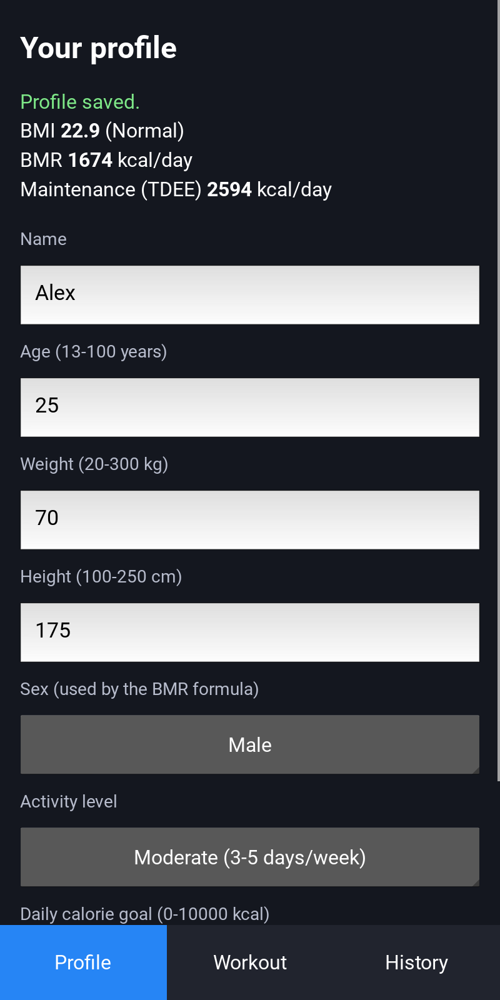
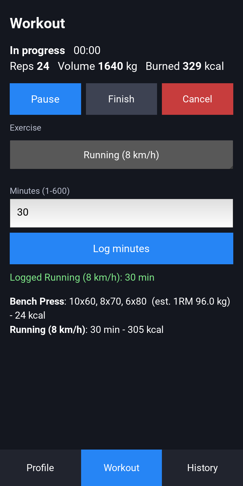
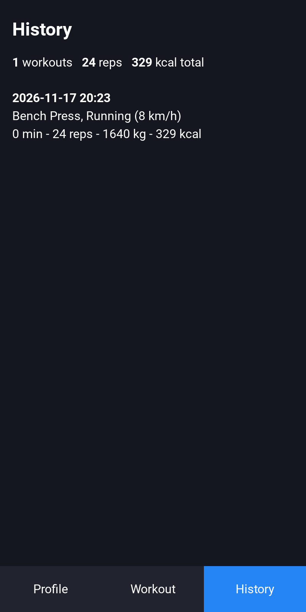

# FitTrack — Fitness & Workout Tracking App

A small, offline-first mobile app for logging workouts. It calculates calories burned, reps, training volume, an estimated 1-rep max, and BMI/BMR/TDEE. It is built by a single developer using the Personal Software Process.

| | |
|---|---|
| Platform | Mobile: Python 3.9+ with **Kivy 2.3** (Android via Buildozer; also runs on desktop) |
| Testing | **Unit** (calorie/rep calculations) · **Boundary value** · **Usability** · state-transition |
| UML | **Use Case · Class · Activity · State** |
| Estimation | **Basic COCOMO** (organic) |
| Process | **PSP** (time/defect logs, PROBE-style size estimate, review checklists) |

<p>



</p>

## Quick start

```bash
# Tests: standard library only, no install needed
python3 -m unittest discover -s tests -v

# Run the app
python3 -m pip install -r requirements.txt
python3 main.py

# Build an Android APK (macOS/Linux)
pip install buildozer && buildozer android debug

# Build for iOS (macOS + Xcode)
#   (run outside the app folder so build files aren't bundled into the app)
pip install kivy-ios && mkdir ../ios-build && cd ../ios-build
toolchain build kivy && toolchain create FitTrack "../fitness app"
open fittrack-ios/fittrack.xcodeproj   # run on Simulator, or sign to run on an iPhone

# Cost estimate from the measured code size
python3 tools/cocomo.py
```

## Project structure

```
main.py                  Kivy UI: Profile, Workout, History screens
fitness/
  calculations.py        calorie / rep / 1RM / BMI / BMR / TDEE (pure functions)
  validation.py          valid ranges for every input (source of boundary tests)
  models.py              UserProfile, Exercise, WorkoutSet, ExerciseEntry, WorkoutSummary
  session.py             WorkoutSession state machine
  storage.py             atomic JSON persistence
  exercises.py           built-in exercises with MET values
  enums.py
tests/                   60 automated tests (unit, boundary, state, storage, SUS)
tools/
  cocomo.py              Basic COCOMO calculator + SLOC counter
  sus_score.py           System Usability Scale scorer
docs/
  01_Requirements.md     scope, FR/NFR, use case descriptions
  02_UML.md              all four diagrams (Mermaid) + design rationale
  uml/*.puml             PlantUML sources (authoritative diagrams)
  03_COCOMO.md           planned vs actual estimate, v2 scenario
  04_PSP.md              PSP plan, defect log, checklists, PIPs
  05_Testing.md          unit cases, BVA tables, usability test plan, heuristic review
  psp/*.csv              time and defect logs
  usability/             SUS response sheet
  screenshots/
```

## Key formulas

| Quantity | Formula |
|---|---|
| Calories (any activity) | MET × 3.5 × body kg ÷ 200 × minutes |
| Strength duration | reps × 3 s + (sets − 1) × 60 s rest |
| Volume | Σ reps × weight |
| 1RM (Epley) | w × (1 + reps/30), valid for 1–12 reps |
| BMR (Mifflin-St Jeor) | 10·kg + 6.25·cm − 5·age + 5 (male) / −161 (female) |
| TDEE | BMR × activity factor (1.2 – 1.9) |
