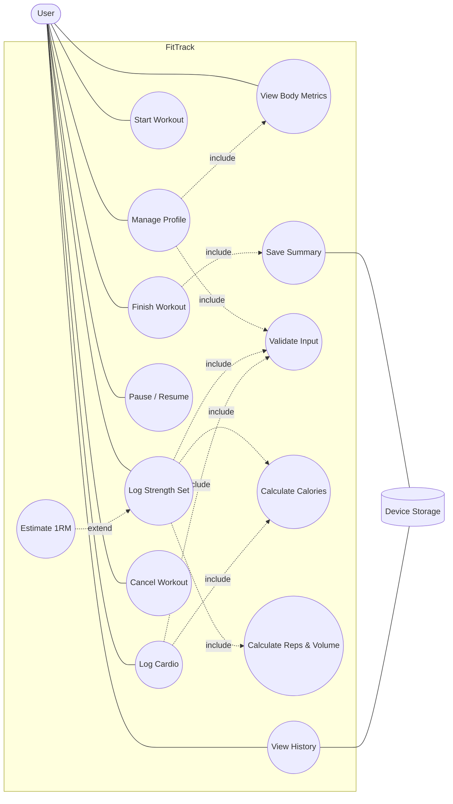
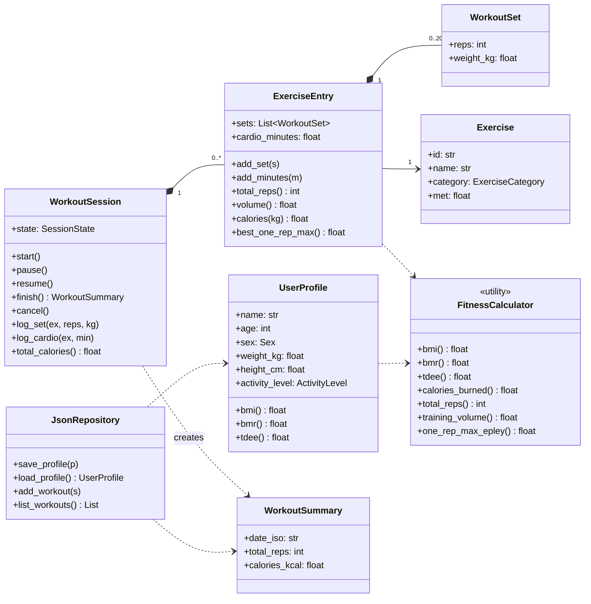
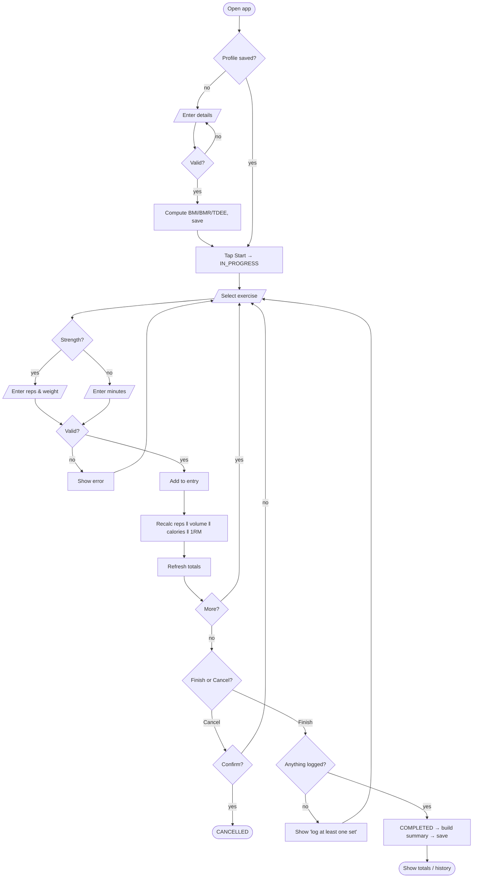
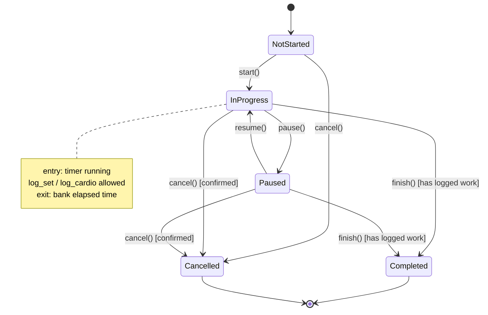

# 2. UML Design — FitTrack

The PlantUML files in [uml/](uml/) are the authoritative diagrams. To render them, use the VS Code *PlantUML* extension (Alt+D) or `plantuml docs/uml/*.puml`. Simplified Mermaid versions follow below. They preview directly on GitHub and in VS Code with a Mermaid extension.

| Diagram | Source | What it shows |
|---|---|---|
| Use Case | [uml/use_case.puml](uml/use_case.puml) | 9 user goals plus `<<include>>`/`<<extend>>` relationships to shared behaviour |
| Class | [uml/class.puml](uml/class.puml) | Domain model, calculator utility, persistence, and the UI layer |
| Activity | [uml/activity_log_workout.puml](uml/activity_log_workout.puml) | The end-to-end "record a workout" flow with User/App swimlanes |
| State | [uml/state_workout_session.puml](uml/state_workout_session.puml) | Life cycle of a `WorkoutSession` (implemented in `fitness/session.py`) |

## 2.1 Use Case diagram

**Design notes**
- *Validate Input* and *Calculate Calories* are `<<include>>` because they run on every log action. They exist once in code (`validation.py`, `calculations.py`).
- *Estimate 1RM* is an `<<extend>>` with a condition: it runs only when the load is > 0 and reps ≤ 12. Above 12 reps, the Epley and Brzycki formulas become unreliable.

## 2.2 Class diagram

**Design notes**
- **Separation of concerns:** `FitnessCalculator` (module `calculations.py`) holds only pure functions with no I/O and no clock. That makes it fully unit-testable, which is the main design driver given the testing requirement.
- **Composition:** a session owns its entries, and an entry owns its sets. Deleting a session deletes them. `Exercise` is shared reference data from the catalogue, so it is an association.
- **Immutability:** `WorkoutSet`, `Exercise` and `WorkoutSummary` are frozen dataclasses. After validation in `__post_init__`, they cannot become invalid.
- **Dependency direction:** UI → domain, never the reverse. `WorkoutSession` accepts an injectable `clock`, so timing can be tested deterministically.

## 2.3 Activity diagram — Record a workout

The PlantUML version adds User/App swimlanes, the fork/join for the parallel recalculations, and the pause/resume branch.

## 2.4 State machine diagram — WorkoutSession

**Traceability to code and tests:** the diagram is implemented one-to-one as the `TRANSITIONS` table in [`fitness/session.py`](../fitness/session.py). [`tests/test_session_state.py`](../tests/test_session_state.py) fires all 5 events in all 5 states (25 pairs). That covers the 8 valid transitions and confirms that the other 17 are rejected and leave the state unchanged (sneak-path testing).
