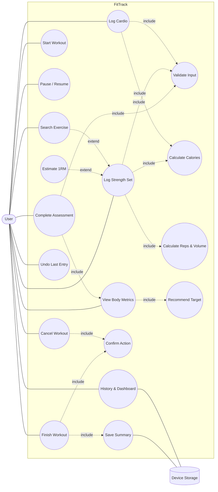
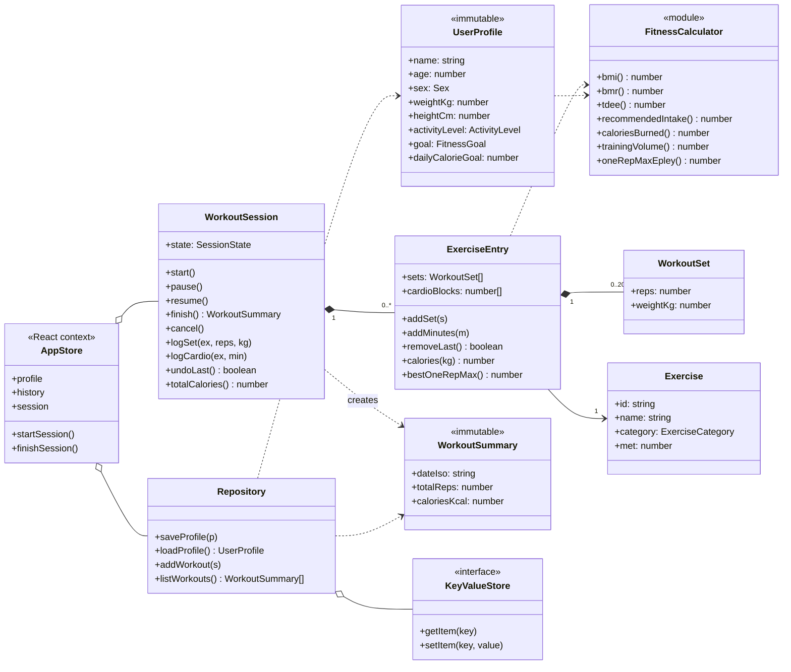
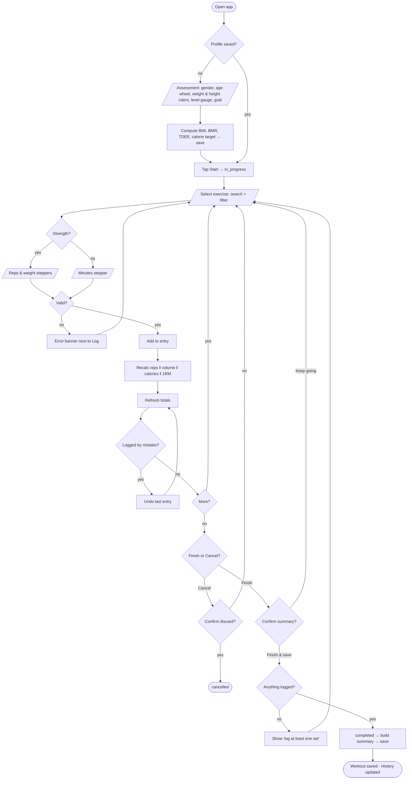
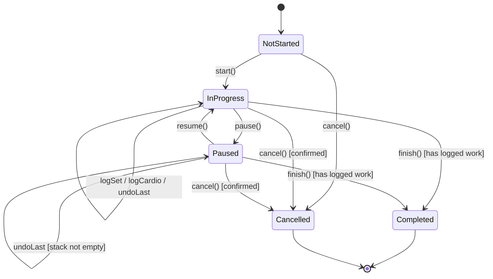

# 2. UML Design — FitTrack

The PlantUML files in [uml/](uml/) are the authoritative diagrams. To render them, use the VS Code *PlantUML* extension (Alt+D) or `plantuml docs/uml/*.puml`. Simplified Mermaid versions follow below. They preview directly on GitHub.

| Diagram | Source | What it shows |
|---|---|---|
| Use Case | [uml/use_case.puml](uml/use_case.puml) | 11 user goals plus `<<include>>`/`<<extend>>` relationships to shared behaviour |
| Class | [uml/class.puml](uml/class.puml) | The pure-TypeScript domain model, persistence behind an interface, and the React Native UI layer |
| Activity | [uml/activity_log_workout.puml](uml/activity_log_workout.puml) | The end-to-end "assess, then record a workout" flow with User/App swimlanes |
| State | [uml/state_workout_session.puml](uml/state_workout_session.puml) | Life cycle of a `WorkoutSession` (implemented in `mobile/src/domain/session.ts`) |

## 2.1 Use Case diagram

**Design notes**
- *Validate Input* and *Calculate Calories* are `<<include>>` because they run on every log. They exist once in code (`validation.ts`, `calculations.ts`).
- *Estimate 1RM* is an `<<extend>>` with a condition (load > 0 and reps ≤ 12). Above 12 reps the formulas become unreliable.
- *Confirm Action* is included by Finish and Cancel. It came from usability finding U-06.
- *Undo Last Entry* (UC11) came from usability finding U-04.

## 2.2 Class diagram

**Design notes**
- **Separation of concerns.** Everything in `src/domain/` is pure TypeScript: no React, no I/O, no global clock. That makes all of it unit-testable in Jest, which is the main design driver given the testing requirement. Screens only read state and call domain operations.
- **Dependency inversion for storage.** `Repository` depends on the `KeyValueStore` interface. The app injects AsyncStorage; tests inject `MemoryStore`. Loaded data is re-validated through `createProfile`.
- **Composition.** A session owns its entries, and an entry owns its sets. `Exercise` is shared catalogue data, so it is an association.
- **Immutability.** `UserProfile`, `WorkoutSet`, `Exercise` and `WorkoutSummary` are frozen after validation, so they cannot become invalid.
- **Testable time.** `WorkoutSession` takes an injectable `clock`, so tests control time exactly.

## 2.3 Activity diagram — Assess, then record a workout

## 2.4 State machine diagram — WorkoutSession

**Traceability to code and tests:** the diagram is implemented one-to-one as the `TRANSITIONS` table in [`session.ts`](../mobile/src/domain/session.ts). [`session.test.ts`](../mobile/src/domain/__tests__/session.test.ts) fires all 5 events in all 5 states (25 pairs). That covers the 8 valid transitions and confirms the other 17 are rejected and leave the state unchanged (sneak-path testing). It also tests undo in each state and timing with a fake clock.
